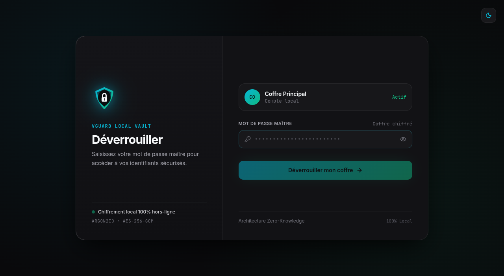
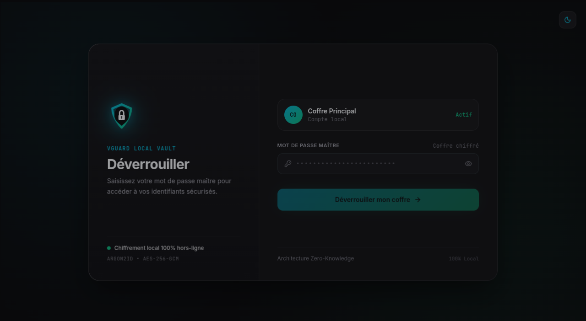

<p align="center">
  
</p>

<p align="center">
  <strong>The Zero-Knowledge, Offline-First Password Manager & 2FA Authenticator Suite</strong>
</p>

<p align="center">
  <a href="#-security-architecture"></a>
  <a href="#-security-architecture"></a>
  <a href="#-security-architecture"></a>
  
  
  <a href="LICENSE"></a>
</p>

---

## 📸 App Showcase

<p align="center">
  
</p>

<details>
  <summary><strong>🔐 View Lock Screen Interface</strong></summary>
  <br />
  <p align="center">
    
  </p>
</details>

---

## 🌟 Overview

**VGuard** is an open-source, enterprise-grade personal cybersecurity suite engineered for developers, security professionals, and privacy enthusiasts who refuse to entrust their credentials to third-party cloud servers. 

Comprising a high-performance **Electron Desktop Vault** and a companion **Chromium Browser Extension (Manifest V3)**, VGuard delivers seamless credential auto-filling and 2FA code injection with **zero network exposure**.

### Key Tenets
- **Zero-Knowledge Architecture:** Master passwords never leave your device. All cryptographic operations occur strictly locally in isolated processes.
- **100% Offline & Air-Gapped Capable:** No remote telemetry, no external font/script CDNs, and no cloud synchronization fees.
- **IPC over Native Messaging:** Communication between the browser extension and the desktop vault occurs exclusively via standard I/O pipes and Unix domain sockets (`/tmp/vguard-$USER.sock`, mode `0600`). Zero open TCP/HTTP ports.
- **Modern Fluid UI:** Inspired by Google Stitch Obsidian design language, featuring binary Dark/Light themes, smooth page transitions, and responsive components.

---

## 🛡️ Security Architecture

| Security Layer | Implementation | Description |
| :--- | :--- | :--- |
| **Key Derivation (KDF)** | `Argon2id` | 64 MB memory cost, 3 iterations, 4 parallel threads. Strongest available resistance against GPU/ASIC cracking. |
| **Vault Encryption** | `AES-256-GCM` | Galois/Counter Mode authenticated encryption with unique 96-bit random IV per write and 128-bit authentication tag. |
| **Memory Protection** | `Buffer.fill(0)` | Master keys, derived keys, and unencrypted vault buffers are zeroized in RAM immediately upon vault locking. |
| **Sandbox & Isolation** | Chromium Context Isolation | The renderer process operates under `contextIsolation: true`, `sandbox: true`, and `nodeIntegration: false`. |
| **Auto-Lock Mechanism** | Inactivity Monitor | Configurable automated locking (1, 5, 15, 30 minutes) and window blur detection. |
| **Secure Clipboard** | Auto-Clearing Timer | Clipboard contents are automatically cleared 30 seconds after copy operations to prevent credential harvesting. |
| **Extension IPC** | Chrome Native Messaging | Standard I/O loop pipe securely forwarded to a local Unix socket with strict filesystem permissions (`0600`). |

---

## 🚀 Features

### 🔑 Desktop Password Manager
- **End-to-End Encrypted Storage:** Manage passwords, usernames, recovery emails, login URLs, categories, and custom secure notes.
- **One-Click Safe Copying:** Instant username and password copy actions with momentary masked visibility toggle.
- **Cryptographic Password Generator:** High-entropy random generator with customizable symbols, numbers, and ambiguous character filtering.
- **Dynamic Password Strength Meter:** Real-time entropy evaluator with 4-segment visual scoring.
- **Categorization & Favorites:** Group entries by *Personal*, *Work*, *Finance*, or *Social*, and star high-frequency credentials.
- **Fast Full-Text Search:** Sub-millisecond multi-field filtering across titles, accounts, domains, and encrypted notes.
- **Vault Import & Export:** Safe encrypted export/import in both structured JSON and CSV formats.

### ⏱️ RFC 6238 TOTP 2FA Authenticator
- **Live Circular Countdowns:** Real-time countdown meters that turn urgent amber and pulse red when expiration is under 5 seconds.
- **Webcam & File QR Scanner:** Built-in scanner with automatic hardware camera shutdown on close to guarantee physical privacy, plus local image drop support.
- **Advanced TOTP Config:** Custom hash algorithm (*SHA-1, SHA-256, SHA-512*), digits (*6 or 8*), and period intervals (*30s or 60s*).
- **One-Click OTP Copying:** Copies clean 6-digit codes directly to the clipboard without dashes or spaces.

### 🧩 Chrome Extension (Manifest V3)
- **Smart Form Auto-Fill:** Automatically detects username, email, and password inputs on web forms and injects matching credentials.
- **Single-Page Application (SPA) Support:** Fires synthetic `input` and `change` events compatible with React, Vue, Angular, and Svelte forms.
- **Domain-Aware 2FA Injection:** Suggests or fills the active domain's TOTP token on 2FA challenge screens.
- **Quick Popup Utility:** Access relevant domain accounts, search the vault, or generate random passwords directly from the browser toolbar.

### 🎨 Visual & Motion Design
- **Dual Strict Themes:** Cyber Obsidian Dark Mode (`#09090B`) and FinTech Clean Light Mode (`#F4F4F6`).
- **Smooth Page Transitions:** 240ms cubic-bezier transitions on view switches and modal popups.
- **WCAG 2.2 / A11y Compliant:** Automatically honors `prefers-reduced-motion: reduce` system accessibility preferences.
- **100% Offline Typography:** Bundles local `Inter` and `JetBrains Mono` font assets.

---

## 🛠️ Getting Started

### Prerequisites
- **Node.js**: `v20.x` or `v22.x` (LTS recommended)
- **npm**: `v10.x` or higher
- **OS**: Linux (X11 / Wayland), macOS, or Windows 10/11
- **Browser**: Any Chromium-based browser (Google Chrome, Brave, Edge, Chromium)

### 1. Installation
Clone the repository and install dependencies:

```bash
git clone https://github.com/RaBYho/vguard.git
cd vguard/2FA_Manager
npm install
```

### 2. Run Automated Verification Tests
Validate cryptographic operations, vault integrity, and Native Messaging IPC:

```bash
npm test
```

> **Test Suite Output:**
> - `crypto-vault-test.js`: Argon2id KDF, AES-256-GCM integrity, Password Generator entropy, RFC 6238 TOTP engine.
> - `vault-integration-test.js`: Full lifecycle, password updates, re-encryption, import/export.
> - `native-messaging-test.js`: Local Unix socket IPC, extension ping, status, and domain credential lookup.

### 3. Launch Development Mode
Run the Electron app with live Vite Hot Module Replacement (HMR):

```bash
npm run dev
```

### 4. Build Production Desktop App
Compile TypeScript, bundle React assets, and package the executable:

```bash
npm run build
npm run package
```

---

## 🧩 Installing the Chrome Extension

### Step 1: Register Native Messaging Host
Register the local host manifest so Chrome/Brave can locate the desktop IPC bridge:

```bash
npm run setup:extension
```
*Configures manifests in `~/.config/google-chrome/NativeMessagingHosts/` (as well as Brave, Chromium, and Edge directories).*

### Step 2: Build the Extension Bundle
```bash
npm run build:extension
```
*Builds the Manifest V3 bundle into `dist/extension/`.*

### Step 3: Load into Browser
1. Open your browser and navigate to `chrome://extensions/` (or `brave://extensions/`).
2. Toggle **Developer mode** in the top-right corner.
3. Click **Load unpacked**.
4. Select the build directory:
   ```text
   <path-to-repository>/2FA_Manager/dist/extension
   ```
5. Pin the **VGuard** shield icon to your extension bar!

---

## 📁 Repository Structure

```text
2FA_Manager/
├── docs/
│   ├── screenshots/          # High-resolution dashboard and lockscreen captures
│   ├── vguard-logo.png       # Official repository header logo
│   └── vguard-icon.png       # Official icon asset
├── extension/                # Manifest V3 extension source code
│   ├── manifest.json
│   ├── background.ts
│   ├── content.ts
│   └── popup/
├── native-host/              # Chrome Native Messaging Host bridge
│   ├── host.js
│   └── manifests/
├── resources/                # OS desktop icons (.png, .ico)
├── src/
│   ├── main/                 # Electron main process
│   │   ├── crypto/           # Argon2id & AES-256-GCM cryptosystem
│   │   ├── totp/             # RFC 6238 TOTP computation engine
│   │   ├── vault/            # Zero-knowledge encrypted vault manager
│   │   ├── ipc-server.ts     # Unix domain socket IPC daemon
│   │   └── index.ts          # Window management and app lifecycle
│   ├── preload/              # Secure contextBridge API exposures
│   └── renderer/             # React 19 + Tailwind CSS frontend
│       ├── components/
│       │   ├── auth/         # LockScreen and SetupWizard
│       │   ├── common/       # Modals, buttons, and theme toggles
│       │   ├── layout/       # Sidebar, TopBar header, and BottomNav
│       │   ├── passwords/    # Password cards, lists, and generator
│       │   ├── settings/     # Preferences, security, and exports
│       │   └── totp/         # 2FA cards, countdowns, and QR scanner
│       ├── public/icons/     # Official multi-resolution icon assets
│       └── styles/           # Google Stitch Obsidian theme & animations
├── test/                     # End-to-end integration and crypto test suites
├── package.json
└── vite.config.mts
```

---

## ⌨️ Shortcuts & Hotkeys

| Shortcut | Scope | Action |
| :--- | :--- | :--- |
| `Ctrl + F` / `⌘F` | Global | Focus omnibox search |
| `Alt + G` / `⌥G` | Global | Open cryptographic password generator |
| `Ctrl + L` / `⌘L` | Global | Immediately lock vault & zeroize memory |
| `Esc` | Modals | Close active modal / scanner dialog |

---

## 📄 License

This project is open-source software licensed under the [MIT License](LICENSE).
Feel free to audit, contribute, and build upon it.
